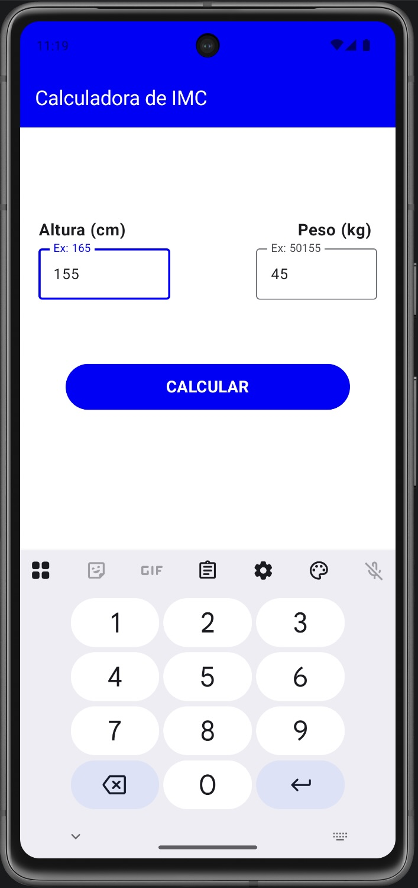
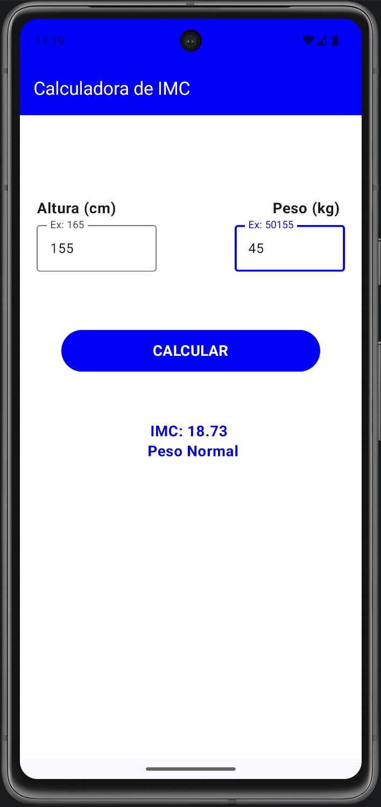

<h1 align="center">
   
  Calculadora de IMC
   
</h1>

  Aplicativo Android que calcula o Índice de Massa Corporal (IMC) a partir da altura e do peso informados

<!-- Peguei as badges no site https://ileriayo.github.io/markdown-badges/ -->

  
  
  
  

### Telas

<table align="center">
  <tr>
    <td align="center">
Tela inicial
</td>
    <td align="center">
Resultado
</td>
  </tr>
</table>

### Como funciona

1. O usuário informa a **altura em centímetros** (ex: `165`) e o **peso em quilos** (ex: `50`).
2. Ao tocar em **CALCULAR**, o app aplica a fórmula:

<b>IMC = peso (kg) ÷ (altura (m) × altura (m))</b>

3. O resultado aparece abaixo do botão com o valor do IMC (duas casas decimais) e a classificação correspondente.

### Classificação

| IMC | Classificação |
|---|---|
| Menor que 18,5 | Abaixo do peso |
| 18,5 a 24,9 | Peso normal |
| 25,0 a 29,9 | Sobrepeso |
| 30,0 a 34,9 | Obesidade (Grau 1) |
| 35,0 a 39,9 | Obesidade Severa (Grau 2) |
| 40,0 ou mais | Obesidade Mórbida (Grau 3) |

### Validações

| Situação | Comportamento |
|---|---|
| Altura com mais de 3 dígitos | O campo não aceita mais caracteres |
| Peso com mais de 7 caracteres | O campo não aceita mais caracteres |
| Peso com vírgula | A vírgula é convertida em ponto antes do cálculo |
| Valor inválido | Os campos ficam vermelhos e aparece a mensagem "Preencha todos os campos!" |

### Estrutura dos arquivos

| Arquivo | Responsabilidade |
|---|---|
| `MainActivity.kt` | Ponto de entrada do app, aplica o tema e exibe a tela `Home` |
| `view/Home.kt` | Interface em Jetpack Compose (campos, botão e resultado) |
| `datasource/Calculations.kt` | Lógica do cálculo e da classificação do IMC |
| `ui/theme/` | Cores, tipografia e tema do app |